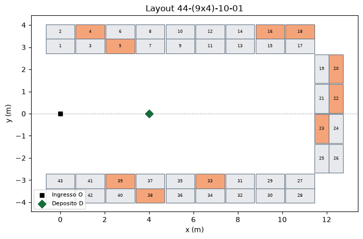
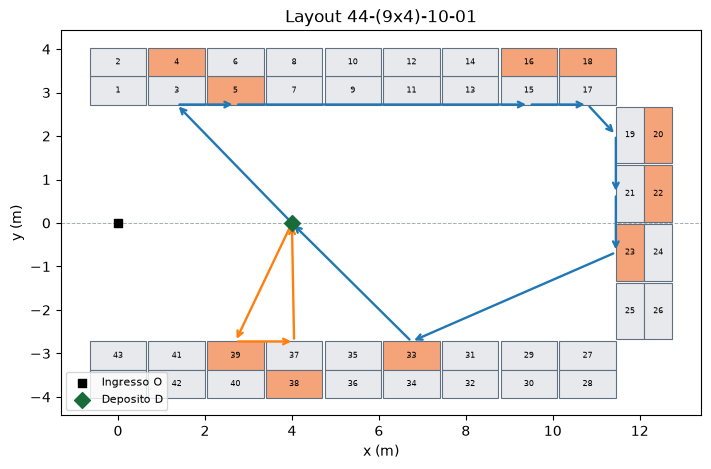
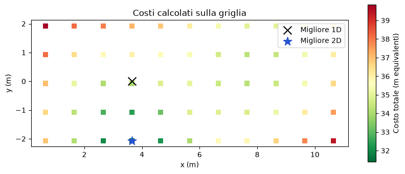
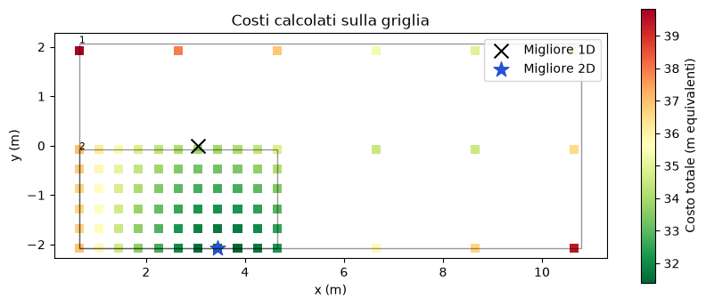

# order_picking_in_U_shaped_corridors

Un progetto didattico per studiare il prelievo di un ordine in una corsia a U, scegliendo sia la posizione di un deposito mobile sia i percorsi del picker. L'obiettivo combina la distanza percorsa dal picker con il costo dello spostamento del deposito dall'ingresso.

Il progetto riproduce gli algoritmi **Basic**, che esplora una griglia di posizioni, e **ZoomIn**, che raffina progressivamente la ricerca attorno alle posizioni migliori. I percorsi si possono risolvere con CP-SAT o Gurobi. Il [notebook CP-SAT](notebooks/picking_deposito_mobile.ipynb) e il [notebook Gurobi](notebooks/picking_deposito_mobile_gurobi.ipynb) illustrano i passaggi; il secondo confronta i due solver.


*La corsia a U, con i contenitori richiesti evidenziati, l'ingresso e una posizione del deposito.*


*Esempio di giri di prelievo per un deposito fissato.*


*La ricerca Basic valuta una griglia di posizioni del deposito.*


*ZoomIn restringe progressivamente l'area di ricerca attorno alle posizioni migliori.*

## Esecuzione

Sono necessari Python 3.13 e [uv](https://docs.astral.sh/uv/). Dalla radice del progetto:

```sh
uv sync
uv run --with jupyterlab jupyter lab
```

Aprire `notebooks/picking_deposito_mobile.ipynb` per CP-SAT o `notebooks/picking_deposito_mobile_gurobi.ipynb` per Gurobi e il confronto tra solver. Per il notebook Gurobi è necessaria una licenza Gurobi 13 valida.

In alternativa, aprire il notebook nell'editor preferito e selezionare il kernel Python della `.venv`. Eseguire le celle in ordine. L'istanza predefinita è `44-(9x4)-10-01`, letta da `instances/PRP-UW-instances.txt`, con capacità `Q = 15`, peso del muletto `ν = 1/3` e limite di 0,5 secondi per candidato.

## Risultati

Nell'output del notebook per l'istanza predefinita, con CP-SAT, i costi totali sono:

| Metodo | Deposito (m) | Costo totale (m) | Candidati |
| --- | --- | ---: | ---: |
| Basic 1D | (3,65; 0) | 34,133 | 11 |
| ZoomIn 1D | (3,05; 0) | 34,057 | 17 |
| Basic 2D | (3,65; −2,075) | 31,387 | 55 |
| ZoomIn 2D | (3,45; −2,075) | 31,405 | 84 |

In questa esecuzione tutti i candidati hanno stato `OPTIMAL` per il modello CP-SAT a distanze arrotondate. I risultati possono variare con i parametri della griglia e il limite di tempo; `FEASIBLE` indica una soluzione senza prova di ottimalità e, se non viene trovata una soluzione entro il limite, costo e distanza possono essere assenti. ZoomIn è un'euristica: il restringimento può escludere posizioni promettenti.

## Modello Gurobi e confronto

Il modello **Gurobi** risolve il problema dei percorsi a deposito fissato con distanze euclidee e vincoli lazy per capacità e connettività. Il modello è implementato in [src/gurobi_routing.py](src/gurobi_routing.py). Il solver si può scegliere anche nelle funzioni Python con `solver="gurobi"`; il valore predefinito è `"cp_sat"`.

Il [notebook Gurobi](notebooks/picking_deposito_mobile_gurobi.ipynb) confronta i due solver con la stessa istanza, gli stessi parametri di ricerca e lo stesso limite per candidato. Nell'esecuzione salvata i quattro metodi individuano le stesse posizioni e gli stessi costi, arrotondati a quattro decimali. Per i candidati selezionati entrambi i solver riportano `OPTIMAL`; non tutti i candidati valutati da CP-SAT hanno ricevuto una prova di ottimalità. I tempi riportati nel notebook descrivono quella singola esecuzione.

Per il confronto principale, entrambi i solver ottimizzano coefficienti di distanza arrotondati a `10⁻⁴` m e ricalcolano separatamente le distanze euclidee dei percorsi. Gurobi può ancora usare l'obiettivo euclideo tramite `objective_profile="euclidean"`, come profilo distinto.

## Benchmark riproducibile

La [guida al benchmark](benchmarks/README.md) spiega configurazione, scenari, ripresa e analisi. Cambiare `active` in `benchmarks/scenari.yaml` per scegliere `tecnica`, `pilota`, `basic_2d` o `completo`, quindi eseguire:

```sh
uv sync
uv run python -m src.benchmark preview
uv run python -m src.benchmark run
```

`preview` mostra lavori e durate stimate senza avviare solver. `run` salva checkpoint per candidato e CSV in `results/<run_id>/`; un nuovo lancio riprende i lavori incompleti. Le stime iniziali in `benchmarks/stime_init.json` sono estrapolazioni dal paper, non misure locali. Il [notebook di analisi](notebooks/benchmark_picking.ipynb) legge i risultati già salvati senza rilanciare i solver.

## Crediti e riferimenti

- Roberto Montemanni, Agnese Cervino e Francesco Lolli, *Picking Optimization in U-Shaped Corridors with a Movable Depot*, ICIEA-EU 2024, Lecture Notes in Business Information Processing 507, pp. 133–145. [DOI: 10.1007/978-3-031-58113-7_12](https://doi.org/10.1007/978-3-031-58113-7_12).
- Diefenbach et al., [descrizione del layout e delle istanze](https://doi.org/10.1007/s00291-021-00663-8).
